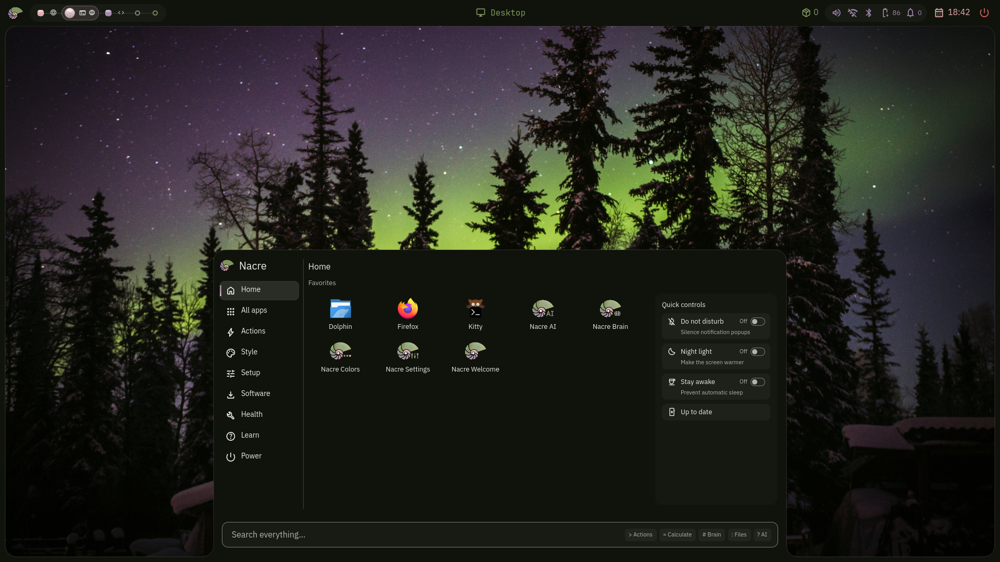
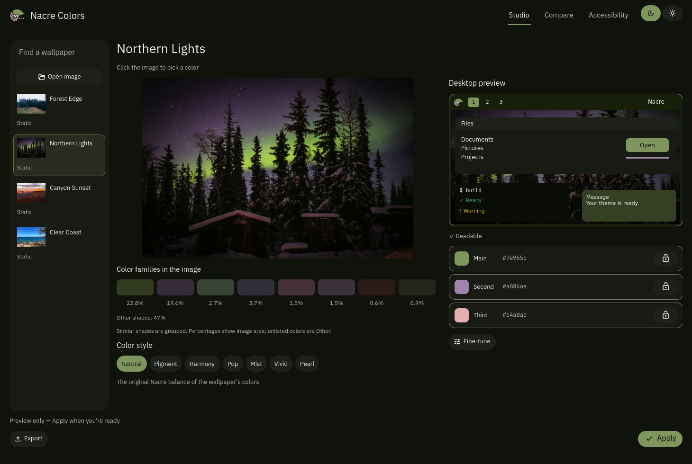
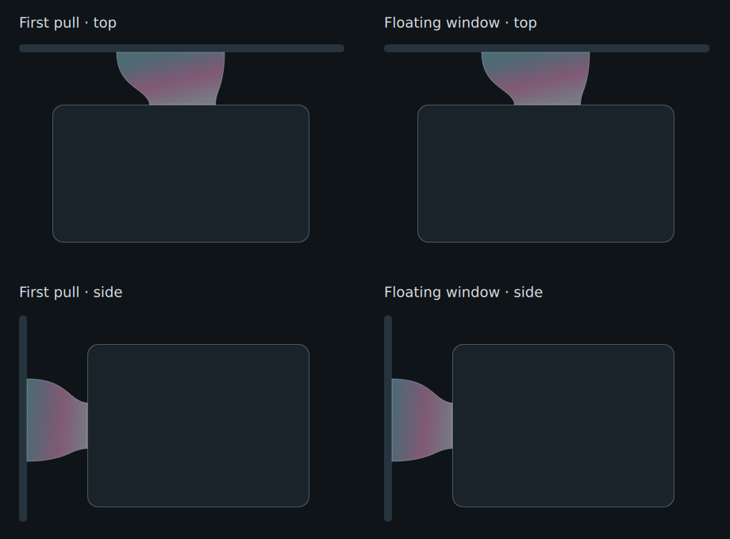

<p align="center"><picture><source media="(prefers-color-scheme: dark)" srcset="assets/branding/nacre-horizontal-dark.svg"></picture></p>
<h1 align="center">Nacre</h1>
<p align="center"><strong>NAY-ker</strong> · mother-of-pearl</p>
<p align="center">A Wayland desktop that takes its colors from your wallpaper.</p>
<p align="center"><a href="docs/installation.md">Install</a> · <a href="docs/first-boot.md">First boot</a> · <a href="docs/keybindings.md">Keys</a> · <a href="docs/theming.md">Theming</a> · <a href="docs/troubleshooting.md">Help</a></p>

<!-- media: media/hero.gif — pick a new wallpaper in the picker; bar, frame, launcher and terminal recolor together -->
<p align="center"></p>

Pick a wallpaper. The bar, the window frame, the launcher, the terminal and your
apps follow it. Nacre runs on [nacre-niri](https://github.com/nacre-desktop/nacre-niri),
its fork of the niri scrolling compositor, with a native shell built on
[Bead](https://github.com/nacre-desktop/bead). Colors come from
[Orient](https://github.com/nacre-desktop/orient). Stock niri and Hyprland work
too, with fewer features (see the [compatibility table](docs/compatibility.md)).

**Status: Nacre is in active daily use and has not yet been released.**

## What you get

- A bar with workspace "pearls", status icons, a clock and a power button.
- One launcher (Super+Space) for apps, windows, files, clipboard, emoji, a
  calculator, actions and web search.
- A control center for Wi-Fi, Bluetooth, sound, brightness, power profiles and
  notifications. A dashboard with media, weather and system pages.
- Wallpaper-derived dark and light palettes, previewed before you apply them, and
  pushed to GTK, Qt, Kitty, Chromium, Discord and Spotify if you want.
- Settings with search. Changes apply as you make them.
- Edge panels you can drag off the edge and use as windows.
- Optional extras: an AI sidebar (Codex or Claude, your own account) and Brain, a
  Markdown notes vault. Neither is installed unless you ask.

## Install

Arch Linux or CachyOS, x86_64. The installer adds a signed pacman repository and
runs setup as your user. Read it first.

```sh
sudo pacman -Syu --needed curl gnupg
curl --fail --location https://nacre-desktop.github.io/nacre/install-arch.sh -o /tmp/nacre-install-arch.sh
less /tmp/nacre-install-arch.sh
bash /tmp/nacre-install-arch.sh --plan
bash /tmp/nacre-install-arch.sh
```

Setup asks which compositor to prepare: **nacre-niri** (everything), **niri** or
**Hyprland** (core shell). Log out and choose the Nacre session at your login
screen. Full steps, updates and uninstall: [docs/installation.md](docs/installation.md).

## First ten minutes

| Do this | Key |
| --- | --- |
| Open the launcher | Super+Space |
| Open a terminal | Super+Enter |
| Pick a wallpaper | Super+W |
| Open Settings | Super+I |
| See every shortcut | Super+K |
| Overview of windows and workspaces | Super+Tab |
| Close a window | Super+Q |
| Lock | Super+L |

More in [First boot](docs/first-boot.md) and the [keybinding cheat sheet](docs/keybindings.md).

## Screenshots

<!-- media (Release lead shot list, not captured yet; add each as an image when it exists):
     media/launcher.gif — Super+Space, type "fire", Enter; then "=2*21", then ">wall"
     media/overview.png — Super+Tab: every workspace and window on one screen, collections to the sides
     media/dashboard.png — top dashboard open on the Media page with weather beside it
     media/settings.png — Settings with a search term typed and the matching row highlighted
     media/panel-motion.gif — hover the right edge: the fill line charges, the control center slides in; click Wi-Fi, open the full panel
     media/nacre-niri-tabbed-column.png — a tabbed column (Super+G) with three windows on nacre-niri
     extra: media/detach.gif — Super-drag the dashboard off the top edge, use it as a window, drag it back -->

| Colors | Docking |
| --- | --- |
|  |  |

## Coming from Omarchy, Noctalia or caelestia?

- The shell is not Quickshell or Waybar. It is Bead: Rust for rendering and
  input, Luau for the UI. Widgets are Luau plugins (see Bead's
  [plugin example](https://github.com/nacre-desktop/bead/tree/main/examples/plugins/hello)).
- Your compositor config survives. On niri, put overrides in
  `~/.config/nacre/niri/custom.kdl`; it is included last. On Hyprland, personal
  shortcuts live in `~/.config/nacre/shortcuts.lua`.
- App theming works like Matugen templates. Orient renders `#{{role}}` tokens
  and a subset of the Matugen expressions, and ships templates for Kitty, Waybar,
  GTK, Hyprland, niri and more.
- Read [Switching to Nacre](docs/switching.md) for the longer version.

## Documentation

- [Installation](docs/installation.md), [First boot](docs/first-boot.md), [Keybindings](docs/keybindings.md)
- [Theming from a wallpaper](docs/theming.md), [App theming](docs/app-theming.md)
- [Widgets and Settings](docs/widgets-and-settings.md), [Configuration and profiles](docs/configuration.md)
- [Detachable panels](docs/detachable-panels.md), [Optional AI and Brain](docs/optional-apps.md)
- [Troubleshooting](docs/troubleshooting.md), [Recovery](docs/recovery.md), [Compositor compatibility](docs/compatibility.md)
- Developers: [architecture](docs/architecture/foundation.md), [build the shell](docs/development/product-shell-build.md), [CI](docs/development/ci.md), [specs](docs/specs/README.md)

## How the family fits together

```text
nacre-niri   compositor (niri fork): windows, workspaces, collections, lock
   ├── nacre        the desktop: bar, launcher, panels, settings, daemon, installer
   │     ├── bead   the shell framework the UI is written with (Rust + Luau, MIT)
   │     └── orient the colour engine that turns a wallpaper into a palette (MIT)
   └── clasp        the login and lock screen (greetd), also built on Bead
```

## Repository layout

| Path | Contents |
| --- | --- |
| `crates/`, `shell/` | Native shell, daemon, shared contracts and Luau product views. |
| `nacre/` | CLI, desktop integration, session tools and the SDDM greeter theme. |
| `config/` | Shipped app configs and install profiles; installed `~/.config/<app>` paths stay unchanged. |
| `ai/`, `brain/`, `bin/` | Optional assistant and knowledge tools, plus installed command entrypoints. |
| `assets/`, `protocol/` | Product art and protocol licensing. |
| `tools/`, `packaging/`, `.github/` | Development checks, installers, package recipes and CI. |
| `deps/`, `vendor/` | Pinned Orient source and vendored dependencies. |
| `docs/` | Guides, architecture and short evidence summaries; see [N0159](docs/specs/0159-root-tidy.md). |

## License

Nacre is GPL-3.0-only ([LICENSE](LICENSE)). `nacre-protocol` is MIT OR
Apache-2.0 so other shells can talk to the daemon. Vendored components retain
their own license notices.
