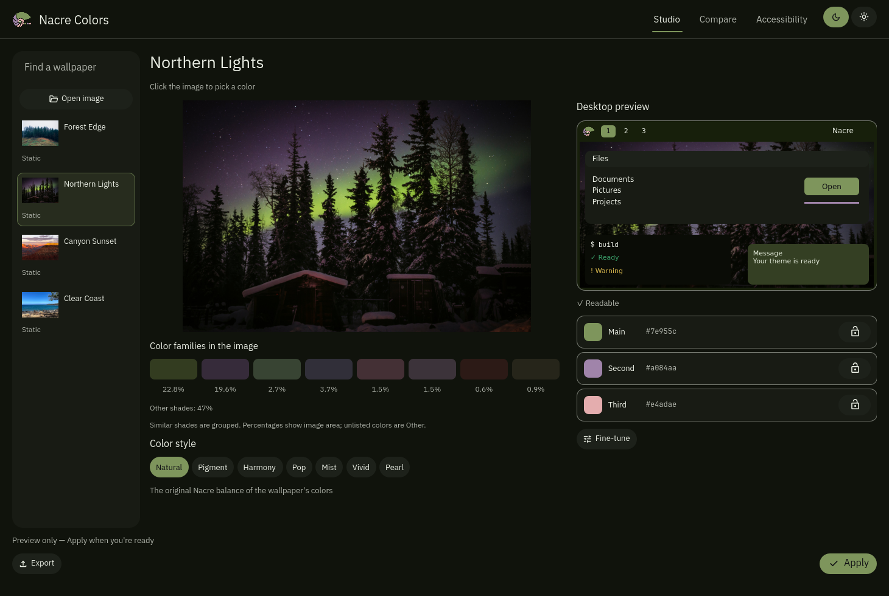
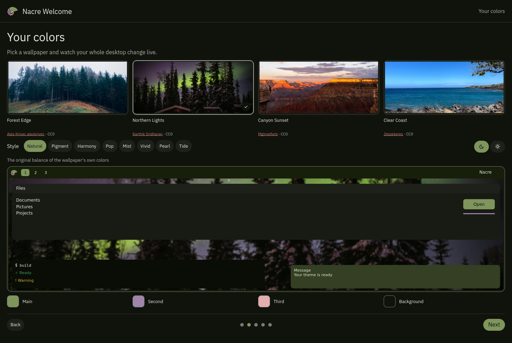

<p align="center"></p>
<h1 align="center">Nacre</h1>
<p align="center"><strong>NAY-ker</strong> · mother-of-pearl</p>
<p align="center">Mother-of-pearl. Colors shaped by your wallpaper.</p>
<p align="center"><a href="docs/installation.md">Get started</a> · <a href="#shortcuts">Shortcuts</a> · <a href="#user-guides">User guides</a> · <a href="https://github.com/nacre-desktop/orient">Orient</a></p>

A desktop for Hyprland, built with Quickshell. Pick a wallpaper and Nacre carries
its colors through the bar, windows, launcher and apps. Keep the wallpaper's own
balance, bring a small detail forward with Pop, or choose a softer style.

**Development preview · 0.1.0-dev.2.** Nacre is in its 0.x series while installation
and packaging settle. The current setup is source-based for an existing compatible
CachyOS/Arch desktop. A guided installer and video tour will come later.

<p align="center"></p>
<p align="center"></p>

<!-- Add the desktop video here once the launch clip is ready. -->

## Your desktop, in its colors

- **Wallpaper colors.** [Orient](https://github.com/nacre-desktop/orient) builds
  dark and light palettes from your images, with distinct styles and readable text.
- **One launcher.** Search apps, actions, settings, clipboard, wallpapers and
  shortcuts. Favorites, live controls and section routes keep everyday tasks close.
- **Nacre apps.** Settings for desktop preferences, Colors for previews and theme
  exports, and Welcome for a hands-on introduction.
- **Static and animated wallpapers.** Browse your library, switch scenes and
  choose motion behavior for battery use.
- **Everyday controls.** Notifications, audio, network, Bluetooth, capture,
  workspace overview and session controls share the desktop's palette.
- **Optional AI and Brain.** Add an assistant workspace and private knowledge
  browser when you want them. Core Nacre works without either.

The default has seven numbered workspaces. Choose your own applications, startup
behavior and workspace names through [configuration](docs/configuration.md).

## Get started

Read the [installation guide](docs/installation.md) for the supported Hyprland,
Qt and Quickshell versions and required packages, then clone the pinned source:

```sh
git clone --recurse-submodules --branch v0.1.0-dev.2 https://github.com/nacre-desktop/nacre.git
cd nacre
npm ci --ignore-scripts
./install.sh --profile default
```

This prints a plan. To inspect the installed file layout first, prepare an empty
directory without changing your running desktop:

```sh
./install.sh --profile default --prepare /tmp/nacre-preview
```

When the prerequisites are ready, provision the color engine and apply the plan
from a running Hyprland session:

```sh
python3 nacre/shell-tools/provision.py
./install.sh --profile default --apply
```

For optional apps, add `--with ai` and/or `--with brain`. Installation does not
sign into providers, download models or populate your memory vault. See
[optional apps](docs/optional-apps.md).

Managed updates check local changes and retain rollback snapshots. Your accounts,
conversations, wallpaper collection and memories remain local user data. Use a
separate test account to explore a fresh setup before changing your daily desktop.

## Shortcuts

**Super** is usually the Windows key. These are the shipped defaults; the launcher
under **Learn → Shortcuts** shows the bindings from your current session.

| Keys | Action |
| --- | --- |
| Super + A | Universal launcher |
| Super + S | Nacre Settings |
| Super + W | Wallpaper picker |
| Super + K | Shortcut list |
| Super + Shift + T | Terminal |
| Super + Shift + F | Files |
| Super + V | Clipboard |
| Super + Ctrl + C | Capture menu |
| Print Screen | Capture an area to the clipboard |
| Super + Print Screen | Save a screenshot |
| Super + Q / Super + Shift + Q | Put a window away / restore it |
| Super + Ctrl + Q | Close a window |
| Super + M / Super + F | Maximize / fullscreen |
| Super + T | Toggle floating |
| Super + 1–7 | Change workspace |
| Super + Shift + 1–7 | Move a window to a workspace |
| Super + Escape | Lock |

In the launcher, `>` searches actions, `=` calculates, `#` searches Brain and `?`
opens AI when installed. Enter opens a search result; Ctrl+D toggles its favorite.

## User guides

- [Installation](docs/installation.md)
- [Using Nacre](docs/usage.md)
- [Configuration and profiles](docs/configuration.md)
- [Optional AI and Brain](docs/optional-apps.md)
- [Updates and recovery](docs/recovery.md)
- [What's changed](CHANGELOG.md)

## License

Nacre-owned source is [GPL-3.0-only](LICENSE). The standalone
[Orient engine](https://github.com/nacre-desktop/orient) is MIT-licensed. System
dependencies retain their own licenses. The temporary bundled landscape wallpapers are public domain.
