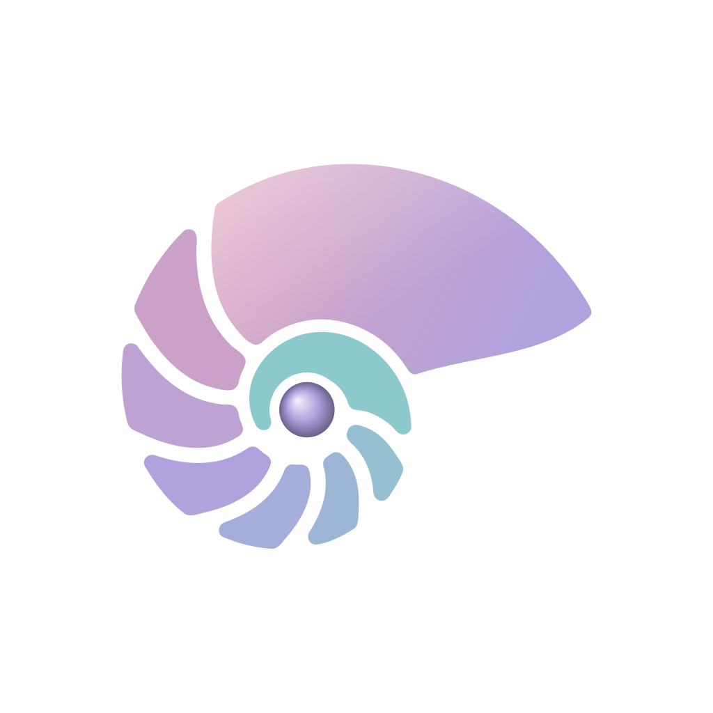

<h1 align="center">Nacre</h1>

<strong>NAY-ker</strong> · mother-of-pearl

Colors shaped by your wallpaper.

<a href="docs/installation.md">Get started</a> · <a href="#user-guides">User guides</a> · <a href="https://github.com/nacre-desktop/orient">Orient</a>

Nacre is a wallpaper-themed Wayland desktop that runs on [nacre-niri](https://github.com/nacre-desktop/nacre-niri), Nacre's own fork of the niri compositor, with a native shell built on the [Bead framework](https://github.com/nacre-desktop/bead). Pick a wallpaper and its colors carry through the bar, window frame, launcher and apps. [Orient](https://github.com/nacre-desktop/orient) builds readable dark and light palettes from images.

**Status: Nacre is in active daily use and has not yet been released.**

[Build and preview the native shell](docs/development/product-shell-build.md).

## User guides

- [Installation](docs/installation.md): install and set up Nacre.
- [Usage](docs/usage.md): launcher, colors and shortcuts.
- [Configuration](docs/configuration.md): profiles and app choices.
- [App theming](docs/app-theming.md): palette colors and app setup.
- [Recovery](docs/recovery.md): TTY recovery, logs and safe resets.
- [Optional apps](docs/optional-apps.md): AI and Brain setup.
- [Detachable panels](docs/detachable-panels.md): open panels as windows.

## Repository layout

- `crates/nacre-shell/` and `shell/`: native Bead shell engine and Luau UI.
- `crates/`, `nacre/`: compositor integration, daemon, protocol and tools.
- `docs/`: user guides, architecture, specifications and research.
- `nacre/login/`: QML-based SDDM greeter.

Nacre also has a Hyprland backend in the code.

## Related repositories

- [Bead](https://github.com/nacre-desktop/bead): the native shell framework.
- [nacre-niri](https://github.com/nacre-desktop/nacre-niri): Nacre's niri compositor fork.
- [Orient](https://github.com/nacre-desktop/orient): wallpaper palette engine.

## License

Nacre is GPL-3.0-only ([LICENSE](LICENSE)).
`nacre-protocol` is MIT OR Apache-2.0.
Vendored components retain their own license notices.
