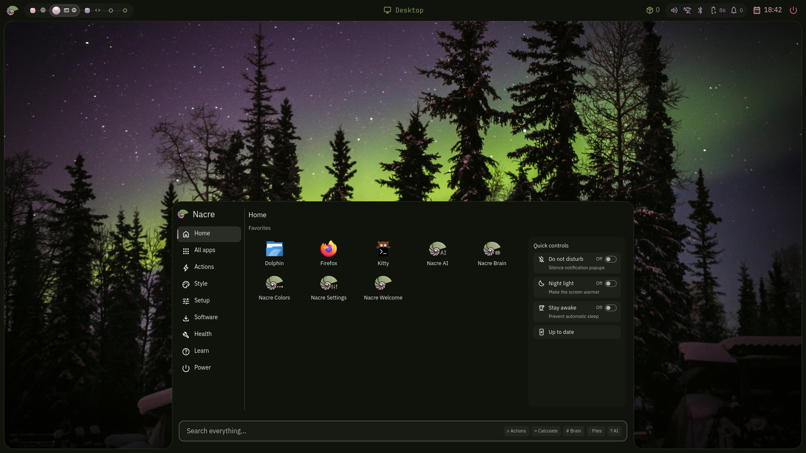

<h1 align="center">Nacre</h1>

<strong>NAY-ker</strong> · mother-of-pearl

Colors shaped by your wallpaper.

<a href="docs/installation.md">Get started</a> · <a href="#shortcuts">Shortcuts</a> · <a href="#user-guides">User guides</a> · <a href="https://github.com/nacre-desktop/orient">Orient</a>

Nacre is a Quickshell desktop for Hyprland, with experimental niri support. Pick a
wallpaper and its colors carry through the bar, window frame, launcher and apps.
The separate [Orient](https://github.com/nacre-desktop/orient) Rust engine builds
readable dark and light palettes: keep the image's balance with Natural, bring
out a small detail with Pop, or choose a softer style.

**Development preview for Arch and CachyOS.** Install the latest verified build
from the [signed package repository](https://nacre-desktop.github.io/nacre/)
using the [installation guide](docs/installation.md). Setup offers Niri,
Hyprland or both, plus optional AI and Brain tools, and installs missing
dependencies. Orient is installed as its own package. After the one-time
repository setup, updates use `sudo pacman -Syu`; no AUR helper or compiler is
needed.

## Features

- **One launcher:** apps, actions, settings, clipboard, wallpapers and shortcuts.
- **Wallpaper colors:** Colors previews palettes and theme exports before applying.
- **Static and animated wallpapers:** browse your library and choose motion behavior.
- **Responsive wallpaper selection:** interactive activation takes priority over background warming; see [N0089](docs/specs/0089-wallpaper-activate-no-flock.md) and [N0091](docs/specs/0091-wallpaper-select-priority.md).
- **Everyday controls:** notifications, audio, network, Bluetooth, capture and locking.
- **Workspace pearls:** see open windows, focus them and switch workspaces from the bar.
- **Detachable panels:** lift supported panels into ordinary windows.
- **Optional AI and Brain:** conversations and a private Markdown knowledge browser;
  the core desktop works without either.
- **Niri session refresh:** `nacre session refresh` validates and reloads the prepared session from the installed backend, so source checkout moves do not break refresh.

The default profile shows five workspaces, with no personal startup apps or window
assignments. Choose your own defaults through [configuration](docs/configuration.md).

## Nacre on niri

Niri support is experimental. Choose it in `nacre setup`, then select
**Nacre (niri)** at login; your existing plain Niri configuration is preserved.
Trash/undo, minimize, scratchpad and sticky windows are unavailable because niri
lacks matching hidden or sticky workspace behavior. Its column layout differs from Hyprland's: pseudo
tiling, split-direction toggles and resize mode are unsupported. Force close and
mirroring also lack supported controls. Live thumbnails need unavailable per-window
capture, and drawer blur needs shaped regions that Nacre cannot yet request.
Stock niri cannot expose overview hover titles; the optional companion adds them.
Niri cannot report private shortcut overrides, and full login, unlock, idle and
hardware checks remain incomplete. See the
[niri parity guide](docs/development/niri-parity.md) for details.

## Shortcuts

**Super** is usually the Windows key. Start with Super+Space for the launcher,
Super+I for Settings and Super+K for shortcuts. Super+Q closes the current window
immediately on both compositors. The [complete shortcut tables](docs/usage.md#hyprland-shortcuts)
come from the same source as the compositor configuration, including
niri differences and the opt-in personal trash bindings.

## User guides

- [Installation](docs/installation.md): packages, setup and choosing a compositor.
- [Usage](docs/usage.md): launcher, colors and shortcuts.
- [Configuration](docs/configuration.md): profiles, app choices and private settings.
- [App theming](docs/app-theming.md): live palette colors and one-time app setup.
- [Updates, recovery and FAQ](docs/recovery.md): TTY recovery, logs and safe resets.
- [Optional apps](docs/optional-apps.md): AI and Brain setup.
- [Detachable panels](docs/detachable-panels.md): open panels as windows.

## Contributing

Read [CONTRIBUTING.md](CONTRIBUTING.md) and the [development guide](docs/contributing.md).
Color analysis belongs in [Orient](https://github.com/nacre-desktop/orient).
Nacre is licensed under [GPL-3.0-only](LICENSE); dependency licenses remain separate.
