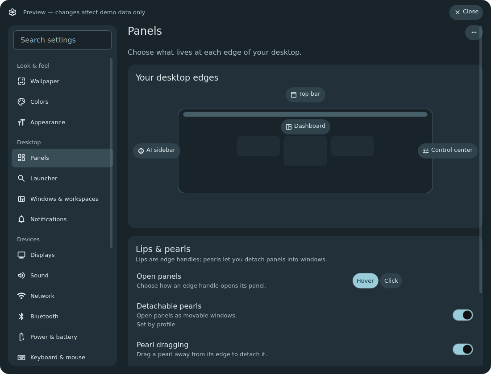
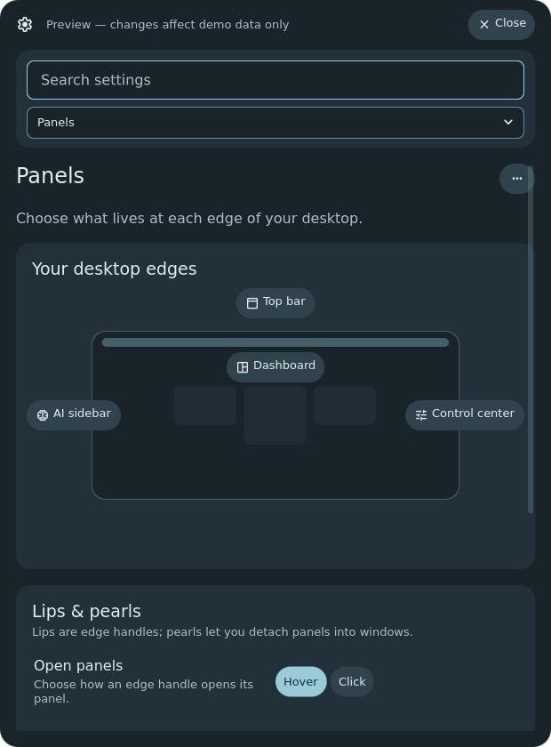
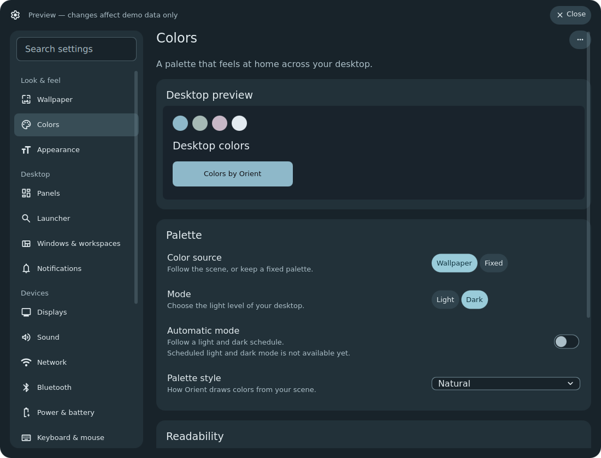
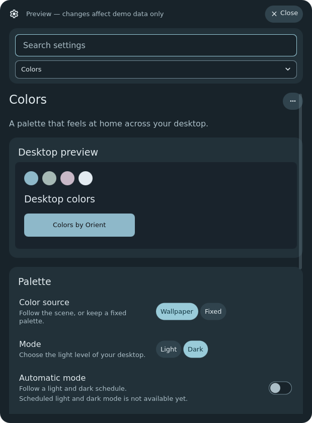
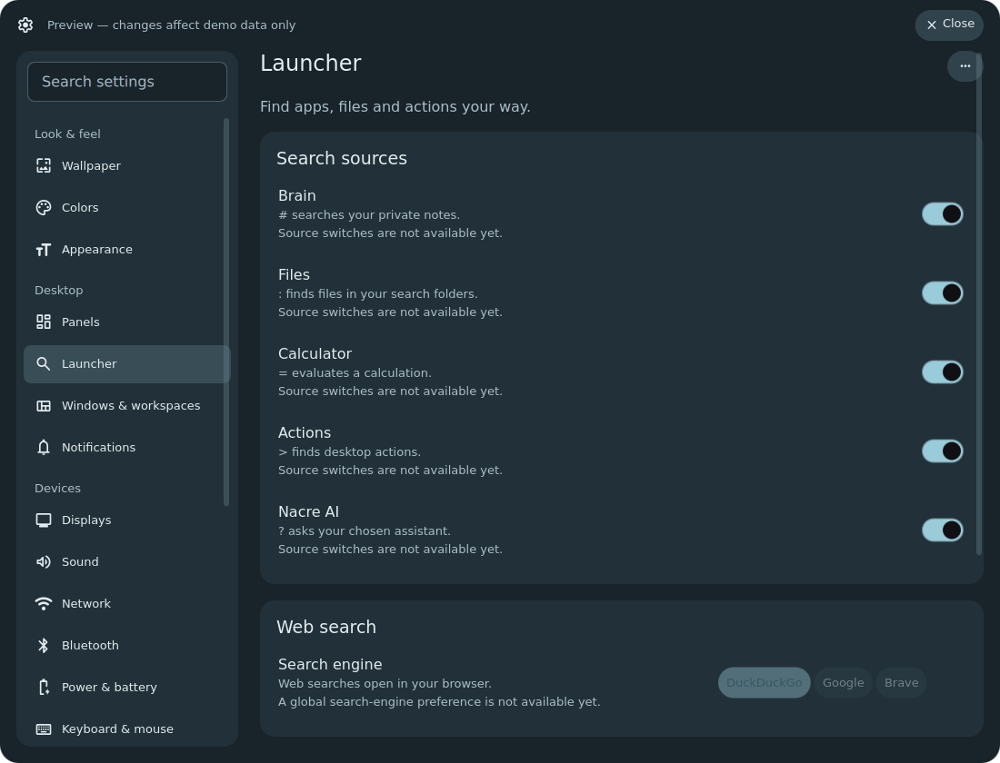
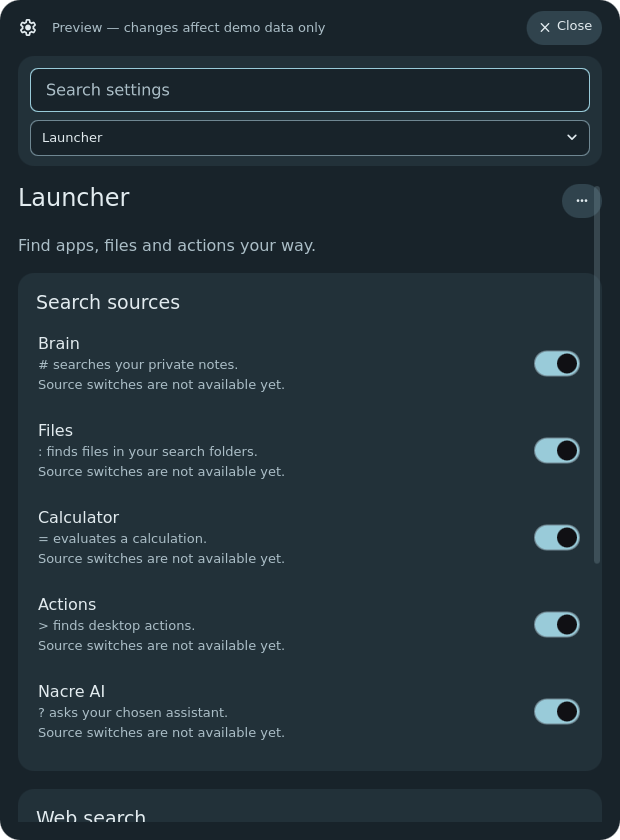
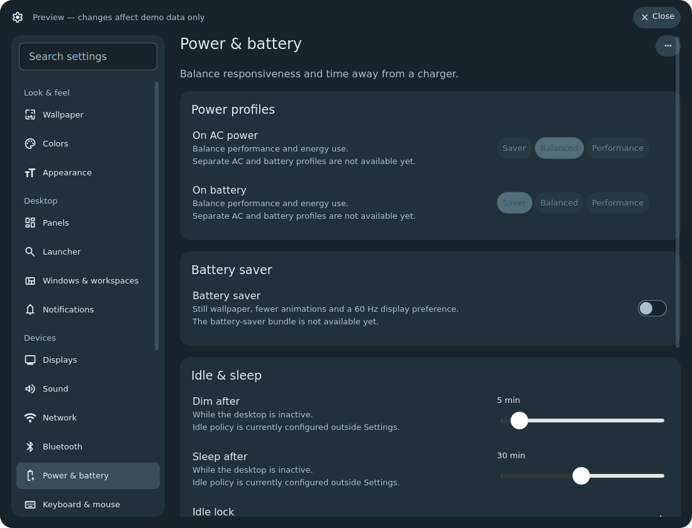
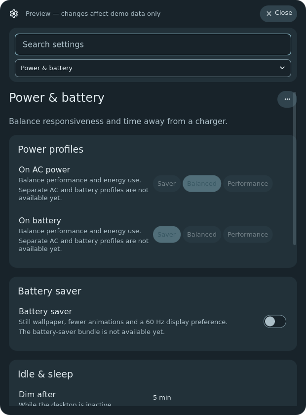
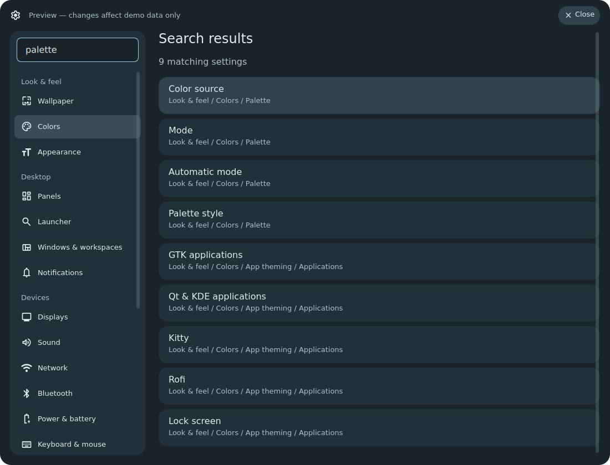
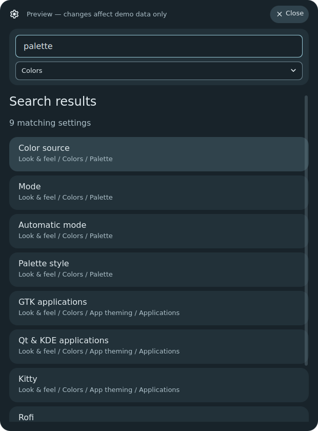

# Settings phase 2 review

The Settings prototype is ready for owner review. The legacy pages and CLI/IPC
entry points remain in place. The existing Settings window's rounded outer
surface is also fixed in source; nothing was deployed to the live desktop.

These are native Qt captures from a private nested Niri session, using synthetic
stores and capabilities. Normal windows are **1100 × 840** logical pixels;
narrow windows are **620 × 840**. The fixture uses DejaVu Sans, the pinned
Material Symbols Rounded font and the foundation size scale. The Colors preview
is representative fixture artwork, not a newly generated Orient palette.

Planned controls are disabled with a reason. A saved value alone would not add a
backend for power policies, theme schedules, per-app theme switches or source
switches. Packages and Software remain schema reservations behind the packages
capability. No installer/package manager was implemented.

## Primary surfaces

Click an image for its full size.

| Surface | Normal | Narrow |
| --- | --- | --- |
| Panels | [](normal-panels.png) | [](narrow-panels.png) |
| Colors | [](normal-colors.png) | [](narrow-colors.png) |
| Launcher | [](normal-launcher.png) | [](narrow-launcher.png) |
| Power & battery | [](normal-power.png) | [](narrow-power.png) |
| Search | [](normal-search.png) | [](narrow-search.png) |

## Details and shared editors

| Detail | Normal | Narrow |
| --- | --- | --- |
| Panels lower section | [Open](normal-panels-lower.png) | [Open](narrow-panels-lower.png) |
| Colors studio / App theming links | [Open](normal-colors-lower.png) | [Open](narrow-colors-lower.png) |
| Launcher entries / history | [Open](normal-launcher-lower.png) | [Open](narrow-launcher-lower.png) |
| Power buttons / alerts | [Open](normal-power-lower.png) | [Open](narrow-power-lower.png) |
| Dashboard Customize (unchanged owning component) | [Open](normal-panels-dashboard.png) | [Open](narrow-panels-dashboard.png) |
| Control center Edit (unchanged owning component) | [Open](normal-panels-control-center.png) | [Open](narrow-panels-control-center.png) |
| App theming | [Open](normal-colors-app-theming.png) | [Open](narrow-colors-app-theming.png) |
| Search result / deep-link row highlight | [Open](normal-highlight.png) | [Open](narrow-highlight.png) |

The long shared editors keep their owner's layout. A section/heading API from
that owner will be needed to trim repeated headings and subdivide the full
editor during migration; this prototype embeds rather than forks them.

## Reproduce and validate

```sh
python3 tools/settings-preview.py --gallery --output /tmp/nacre-settings-gallery
# Interactive nested review; close its window to clean up the session:
python3 tools/settings-preview.py
```

Requires Niri, Quickshell, D-Bus and fontconfig. A missing pinned icon font is
fetched into the disposable preview tree with size/hash verification; it is
never installed. The preview uses a private HOME, XDG paths, D-Bus and Wayland/IPC
sockets. All child processes run nice 10. It reads no personal stores and calls
no live shell, package, systemd or hardware mutation APIs.

The harness verifies native file acknowledgements for click/hover and
light/dark changes, restores the initial choices, rejects wrong types, checks
battery and AI route gates, and verifies legacy AI fallback to Add-ons.
[Capture metadata](gallery.json) records the base revision and exact hashes of
prototype source inputs because images are captured before their commit.
The only nested warning was Qt's Wayland text-input focus warning; there were
no QML scene/parse errors. The native Qt unit suite passed without QWARN.

[Architecture, inventory and research](../../../docs/development/settings-architecture.md)
contain the final destinations and backend boundaries. Owner review should cover
group names/findability, diagram behavior, row density, narrow navigation,
Colors studio boundary and unavailable-feature treatment. **Phase 3 has not begun.**
