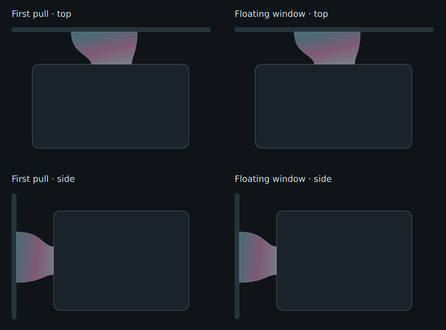

# Detachable panel design and research

This feature uses existing, owned Nacre components in normal Quickshell windows.
It does not embed terminal windows or introduce another desktop/settings owner.

Primary references:
- Quickshell FloatingWindow: https://quickshell.org/docs/v0.3.2/types/Quickshell/FloatingWindow/
- Qt native movement and Wayland positioning: https://doc.qt.io/qt-6/qwindow.html#startSystemMove
- Established floating/docking behavior: https://doc.qt.io/qt-6/qdockwidget.html
- Hyprland movement/resize dispatchers: https://wiki.hypr.land/configuring/core/dispatchers/
- Quickshell implementation confirms window-wide app IDs rather than a per-window
  FloatingWindow.appId: https://github.com/outfoxxed/quickshell/blob/master/src/window/floatingwindow.hpp

Nacre targets Hyprland, so initial placement and intentional docking use its real
client geometry. Each window has a unique, human-readable Nacre Pearl title; only
owned titles/processes are manipulated. A title rule floats them by default; tiling
is a user choice. Never take an arbitrary focused window for placement or pinning.

Super+left-drag is routed by an owned Lua binding. It passes the press only
inside the shell's published popup rectangles, with a mapped-layer/PID guard.
An explicit, non-consuming left-button release binding finishes each transaction,
even when Super is released first. Native implicit releases and explicit releases
share idempotent cleanup: release runs at most once per transaction. Hyprland 0.56
ignores a Lua callback's returned `request_release`, so shell-layer pulls must not
depend on that newer flag. Native movement ends in Hyprland's mouse handler; the
release callback does not dispatch another native drag.

Elsewhere it dispatches normal Hyprland window movement. Geometry is throttled to
the next frame during panel changes (never debounced until an opening animation
ends); no external process runs inside the pointer callback. Native pearl movement
uses a 33ms compositor timer only for the duration of a Super-drag. It emits
coordinate-change events through Hyprland, and disables on release. The shell
handles every new begin/move/end transaction independently, shows a
pointer-transparent magnetic film, and docks on release at the matching edge.
Each native transaction captures the owned window's initial geometry once through
Hyprland's existing callback, then derives its moving rectangle from the pointer
delta. The first lift and native movement both use `Geometry.magnet`: enter at72
logical pixels from the frame, release the target beyond104, and show the film
within170. Monitor coordinates are already logical; no extra scaling is applied.
The target requires overlap along the edge and has one owner at shared monitor
seams. A click without a16px pull cannot dock a native window. No native drag polling runs idle.

A Qt DragHandler reserves Super and moves the original live item within its existing
layer surface. The layer retains its keyboard focus mode while dragging. Hover exit timers pause
instead of converting a passive panel to an exclusive keyboard grab. Only an
UngrabExclusive event with EventPoint.Released completes the transaction; canceled
or disabled grabs return without creating a window. The sensor is a stationary sibling, not a child of the moving panel;
its press geometry is frozen so translations never feed back through parent movement.
Opening motion finishes before capturing body dimensions. At handoff the old view is
suppressed rather than replaying its closing animation at the edge. Its footprint is excluded from the joined frame while lifted. On
release, an ordinary window is created with the same body dimensions and exact
logical coordinates, with no added header or body inset. The client paints its neutral/focused gradient border with the panel content.
Compositor border and focus-ring decorations are disabled only for owned pearls. The original stays
painted until placement completes and two explicitly requested destination frames
have been submitted. A placement acknowledgement alone does not finish the handoff. There is no screenshot ghost or second miniature panel. A finite, input-free
shared `NacreDockFilm` membrane stretches from the frame to the moving panel,
thins, and breaks over170 logical pixels. `NacreDockGuide` owns the same decoration
for initial and subsequent pulls, with a160ms return/fade and no duplicate layer
renderer. Reduced motion leaves the static cue and disables its animation. This respects
the distinction between Wayland layer-shell and xdg-shell surfaces: their protocol
roles cannot be changed during a mouse grab. A finite fallback releases the lift if
placement fails. The deliberate Super gesture needs only 16 logical pixels in any direction.
A short pull or release within the magnetic zone animates back without opening a
window on the same output. Crossing to another output keeps the existing tested
window handoff before docking there, preserving view state.

View state is independent of shared providers. Launcher contexts share catalogues
and system snapshots, with local query results. Provider visibility combines edge
and visible detached views, retaining one Cava/resource/control sampler. AI view
leases share one model per conversation; named session namespaces preserve the
existing default server and allow a fresh sidebar without restarting a busy worker.
Drafts/accounts/auth remain private. Closing a view parks its session; it does not
interrupt an assistant. Same-chat selections focus the existing owner.

Acceptance: real Super-drag/dock and short/canceled pulls on all four edges; two
independent launchers and dashboards; same-chat focus; retained drafts and busy
workers; normal Escape/outside-click behavior; tiling/resizing/pinning; provider
idleness; reduced motion; compositor placement and isolated geometry tests including
negative monitor origins and mixed scales. Physical multi-monitor coverage must be
reported honestly. Publish upstream first, then update the personal consumer pin.

Detached layouts use actual viewport dimensions. The Dashboard page bounds its
content width and summary/card height, allocating spare space to the wallpaper hero.
Launcher rows stay within72–100 logical pixels; they are not one-fifth of an
arbitrarily tall window. Gallery switching can grow an undersized owned window via
`pearl-window.py fit`, with scaled/rotated monitor and reserved-area bounds; maximized
windows are left alone. Full handoff positions are aligned to compositor logical
pixels, and geometry helpers read their resulting state after writes.

## Shared magnetic cue

This native Qt render uses `NacreDockFilm` with fixed demo colors and plain
placeholder panels; it contains no personal desktop content or third-party
artwork. Production uses the current Orient colors. Both paths render the same
component, with no line-only fallback or extra pop-out copy.

Native-to-edge docking must not dismiss a panel while it is still growing under
the stationary drop pointer. Each panel exposes its actual opening animation
state. The input controller pauses hover-exit timers only during a docked opening,
then evaluates the current hover immediately when the animation finishes. This
also handles reduced motion without a fixed timeout, and closes normally if the
pointer moved away during the animation. Ordinary hover and keyboard focus policies
remain unchanged.

## Direct restoration and Niri release tracking

Docking restores a panel at full size before removing its native window, instead
of replaying the ordinary menu-opening animation. The attached host keeps opening
motion disabled for restored size changes (including asynchronous launcher pages),
while closing and future ordinary menu openings still animate. View state and
hover dismissal remain independent of this presentation flag.

Niri 26.04's `Layout::with_windows` publishes interactively moved windows with no
workspace and no positions, then restores the workspace/geometry at release:
https://github.com/niri-wm/niri/blob/v26.04/src/layout/mod.rs . The adapter exposes
that movement state, and the backend emits observed begin/end events. It waits
for valid final geometry if workspace metadata arrives later, cancels on removal
or disconnect, and never treats an idle pause or programmatic move as a drop.
Only an owned ready floating pearl that began an observed move can dock.

The shared magnetic target uses the reported output and final panel edge. Niri
currently hides positions during native movement and has no cursor IPC; therefore
`nativePanelDrag` remains false for continuous native tracking. Native docking
works at release. Niri uses the same stationary landing field for both first and
later native pulls; Hyprland retains its live membrane on both paths.

The common landing field now marks every matching output edge during either kind
of drag. It is a stationary iridescent target, not a guessed cursor/window position.
Niri therefore has feedback for the entire observed native move despite hiding
its moving coordinates. The dynamic membrane remains enabled on Hyprland, which supplies live geometry
for both paths. Niri consistently uses the landing field alone on both paths. Both decorations fade out, accept no input,
and run no animation while idle; reduced motion removes the fades.

`restoreAttached()` reinstates each panel's size binding explicitly. Completing a
Behavior animation before Qt has started it does not apply its queued target;
production-QML regression tests previously observed zero size on all four panels.
The explicit binding/sizing restore is synchronous, while ordinary close and
future fresh-open animations remain intact. The control center defers its normal
visibility-size update until its Behavior enable binding has settled.

Fast pulls use the pointer's scene press/current/release coordinates, including
the movement that activates the gesture. They do not depend on the translation
property being populated after activation. A fresh pull can interrupt a completed
magnetic return, while an actual native-window handoff remains protected.

Redocking keeps the floating source until two explicitly requested destination
frames have been submitted. Hover dismissal pauses during this bounded transfer.
Static destinations request their second frame rather than waiting for unrelated
animation. If no destination frame arrives within500ms, keep the floating window
and roll back the edge view; never hide an unpainted source. No idle polling or
image readback is involved.

Both directions use the same frame barrier. A newly placed floating panel publishes
`painted` only after its destination frames, rather than a fixed34ms delay.
`ready` means compositor placement succeeded; it must not be treated as rendering
completion. Failed presentation returns to the original edge panel.

Niri's IPC deliberately omits animated render offsets and its placement action
always animates. Exact initial floating placements therefore remain transparent
for a finite400ms settling interval under the retained source before requesting
the destination frames. This covers the stock26.04 critically damped movement
spring at normal speed; slower custom compositor animations may still outlast it.
Ordinary standalone windows, Hyprland handoffs and later native drags do not use
this interval. It creates no idle work and changes no compositor configuration.

`NacrePearlBorder` paints a2px rounded neutral outline, switching to the Orient
gradient on focus or hover. It is inside the reveal-controlled client surface.
Neither Niri nor Hyprland draws an additional border for these owned windows, so
a transparent destination cannot leak an independently moving outline. Ordinary
application decorations remain compositor-owned.

The drag observer retains a passive first press even if an on-demand Wayland
focus handoff delays the modifier state. Its threshold is enabled only while
Super is reported; ordinary presses never reach the reserved gesture threshold.
This permits the original press to become a Super-drag as soon as modifiers
arrive, instead of requiring a second press. Bare clicks and normal control
drags remain covered by the native Qt interaction tests.
