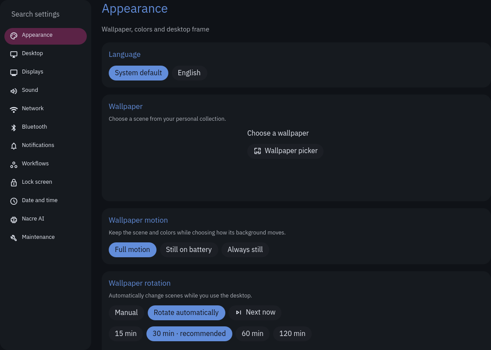
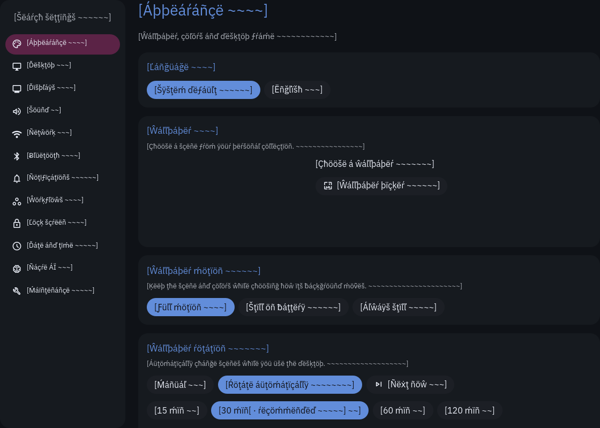
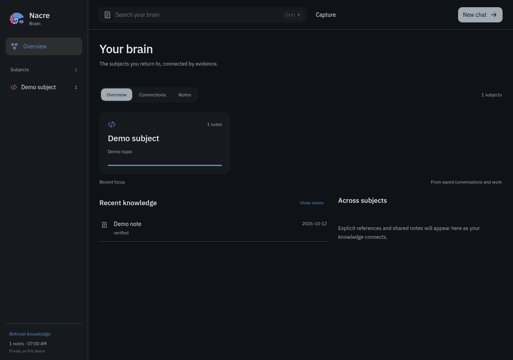
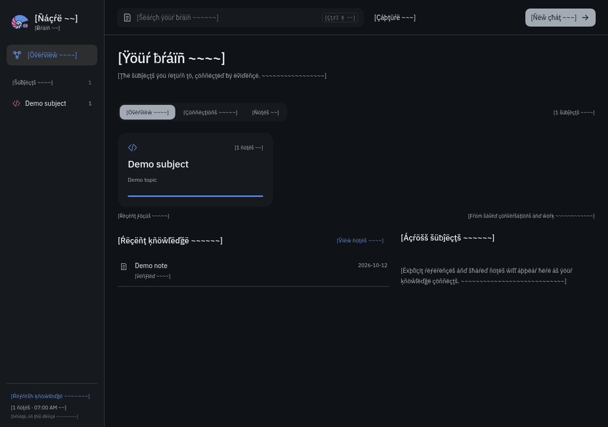

# Translations

Nacre's English messages live in `nacre/shell/i18n/en.json`. No additional real
languages ship yet. `context.json` contains translator notes; `options.json`
connects stable enum values to display-message IDs. These two files are metadata,
not language files.

## Add or change a message

Use a stable, dotted ID and preserve the existing English wording:

```qml
text: NacreI18n.tr("launcher.search.placeholder", "Search everything…")
```

Add the same ID and English text to `en.json`, with a short note in `context.json`.
Keep the ID when wording changes; update the English source and fallback together.
Give ambiguous words context: "Open" on a button is a verb, whereas a window state
may need a different translation. Do not reuse an ID merely because its current
English happens to match.

Translate complete messages. Put dynamic values in named placeholders:

```qml
text: NacreI18n.tr("example.workspace", "Workspace {workspace}", {
    workspace: workspaceNumber
})
```

For counts, use `one` and `other` forms and pass the numeric count:

```json
"example.windows": {
  "one": "{count} window",
  "other": "{count} windows"
}
```

```qml
text: NacreI18n.tr("example.windows", {
    one: "{count} window", other: "{count} windows"
}, {count: windowCount})
```

Do not assemble sentences from separately translated fragments. Translators must
be able to reorder placeholders. User text, paths, URLs, application-provided
content, key sequences and file-filter patterns stay in arguments. Pseudo mode
preserves placeholders and HTML tags; arguments are substituted afterward.

Use `NacreI18n.number`, `date`, `time` and `dateTime` for displayed values. Keep
machine formats, hexadecimal colors, timestamps and command arguments separate.
The locale controls presentation; a missing language or message falls back to the
English source. English and pseudo currently use the English cardinal plural rule.
A new language with different plural categories needs a matching rule and tests
before it can be offered as a supported Language choice.

## Catalogs and helpers

Launcher rows retain their stable command ID and English fallback. Add `labelId`,
`descriptionId` and, where applicable, `confirmId`. Built-in catalogs require these
companions. Settings and Welcome catalogs similarly pair visible fields with IDs.
Their presentation layer localizes copies; command values remain unchanged.
User extensions may keep custom labels. Overriding a built-in English field drops
its inherited message ID unless the extension explicitly supplies a replacement.

Standalone Python desktop helpers use `nacre_i18n.tr(id, fallback, args)`. They read
the same English catalog. The small CLI bridge supports notification messages in
compositor shell scripts. Keep notification sender identities and compositor
window identifiers stable; localize the captions that Nacre renders for users.
Native window rules and panel ownership checks must not depend on a translation.

The login greeter uses the same message engine without requiring Quickshell.
Its generated `messages.js` subset comes from the English source. Its developer
preview accepts `configuration.language: "pseudo"`; installable theme assets
include the engine and generated messages. Never test authentication or change
someone's live login configuration to check translations.

## Check English and pseudo

Language offers **System default** and **English**. Pseudo appears in the Language
setting only when `NACRE_DEVELOPER_MODE=1`; it can also be selected directly with
`NACRE_LANGUAGE=pseudo`. The environment override wins over the saved preference.
Use an isolated preview or test account, not the maintainer's daily preferences.

Pseudo accents letters, expands messages by roughly 40% and surrounds them with
brackets. Inspect the launcher and its forms, all Settings pages, Colors, Welcome,
the dashboard, control popups, tooltips and notifications. Check long labels,
small windows, keyboard operation, placeholders and plural counts. External app
names, user content, icon names and protocol data are not translated.

```sh
python3 tools/i18n/check.py
python3 tools/i18n/generate.py
python3 tools/i18n/tests.py
python3 tools/check.py
```

CI rejects unwrapped owned QML/catalog literals and missing/unused English IDs.
Native tests exercise the message engine, locale formatting, English fallback,
pseudo protection and existing English interactions. New UI needs a message ID and
a translation test alongside its behavior tests.

## Translation platform setup

Use **monolingual JSON**, with `en.json` as the source-language file. Weblate and
Crowdin can edit the ID-to-text JSON; nested `one`/`other` entries are the plural
message forms. Import only language JSON files, not `context.json` or `options.json`.
Supply translator context from `context.json`, preserve placeholder names and
validate the result with the coverage checks before adding a language.

Qt's locale-aware date and number APIs are documented in the
[Date](https://doc.qt.io/qt-6/qml-qtqml-date.html) and
[Locale](https://doc.qt.io/qt-6/qml-qtqml-locale.html) references. Weblate documents
[monolingual source files and formats](https://docs.weblate.org/en/latest/formats.html).

## Optional app surfaces and generated assets

Brain's browser UI uses message IDs for its HTML text/attributes and JavaScript
labels. It shares the desktop message engine through a generated browser copy.
The existing local-host asset route provides the scripts; private API data still
requires its session cookie. Notes, subjects and search results remain user content.
The requested language is read at page load without
changing account or vault configuration.

The terminal AI menu uses canonical `UiLabel` strings for dispatch, with translated
captions only when painted. Do not compare against translated captions. Project,
account and conversation labels remain user data. The standalone controller falls
back to English when the desktop translation assets are not installed.

After editing English messages or the shared engine, regenerate the login/browser
assets and run their formatters through the generator:

```sh
python3 tools/i18n/generate.py --write
python3 tools/i18n/generate.py
```

CI checks generated content against its source. Do not edit generated language
subsets or the browser engine copy by hand.

## Audit progress

2026-10-12: resumed the existing translation branch without discarding its pending
changes. Completed the shared browser-engine generation, verified generated login
and browser assets, and strengthened browser DOM and local-host/API-boundary
checks. The source guard now covers disabled-action reasons, battery estimates,
indirect status properties and browser rendering factories. Proper font names,
media capability keys and command values remain unchanged.

The first full `tools/check.py` run passed 544 tests plus Python, shell, Lua, Qt and
browser checks. Subsequent targeted checks passed for message coverage (1,933
messages), generation, native launcher dispatch and browser authentication/DOM
behavior. The final full run and pseudo layout audit remain pending at this
checkpoint. Native previews identified expansion problems in Settings navigation,
Colors search, calendar weekdays, control tiles and launcher toggles; fixes are
being checked against production widgets. No translation deployment was performed.

2026-10-12 audit follow-up: translated indirect form buttons, header sections,
hover hints, forecast notes and owned battery/focus notifications. Welcome now
keeps shortcut group keys canonical and supplies title IDs, so changing language
cannot hide shortcut rows. Browser theme keys and grouping comparisons also remain
canonical. Its real headless-browser audit covers overview, connections, notes,
subject, reader, grouping, narrow layout and search using public demo content.
Only demo content/paths remain outside pseudo wrappers; no owned truncation was
reported. Message coverage now contains 2,015 messages.

Native audit tooling renders real presenters with synthetic providers in temporary
Qt fixtures, captures English/pseudo screenshots and a JSON text/geometry report,
and rejects owned English literals or truncation. It includes all Settings pages,
Colors pages, Welcome pages, launcher catalog routes/forms/search scopes, controls,
bar/calendar/battery popups, dashboard pages, media, chat, wallpaper layouts,
notifications, session actions and the login greeter. Daily preferences, devices,
notification delivery and authentication are not operated by this audit.

```sh
python3 tools/i18n/audit.py --output /tmp/nacre-translation-audit
```

The optional browser audit uses Playwright from an isolated developer environment
(no application runtime dependency). Its HTTP requests are intercepted with public
fixtures, so it does not read the private vault or contact the running Brain app:

```sh
NACRE_PLAYWRIGHT_MODULE=/path/to/isolated/node_modules/playwright node tools/i18n/browser-audit.cjs /tmp/nacre-browser-audit
```

The final combined-baseline rebase and full checks remain pending at this checkpoint.

2026-10-12 layout checkpoint: adaptive navigation/search widths, wrapping control
and menu labels, size-aware action buttons and fitting weekday headings remove
the observed pseudo clipping. The native expanded gallery covered 181 states per
language with no owned truncation; the browser covered eight states per language.
The audit uses offline public fixtures, so real hardware transitions, compositor
integration, lock/resume and a cold login remain outside its verification scope.

## Completed review checkpoint

2026-10-12: rebased onto the combined compositor/performance baseline `fa37a28`.
Conflict resolution retained opaque compositor IDs, persistent helper callbacks,
adapter availability checks and canonical window identities. The additional
queue/device captions are localized, and support-report catalog companions match
the new baseline. Generated compositor code remains canonical in pseudo mode.

Final validation passed:

- `tools/i18n/check.py`: 2,025 owned messages with matching English/context IDs.
- `tools/i18n/generate.py`: login/browser assets reproduce exactly.
- `tools/check.py`: 633 tests (120 tools, 102 AI, 38 Brain, 373 desktop helpers),
  plus Python/Qt/JS/Lua/shell checks and compositor/generated-configuration checks.
- `tools/i18n/audit.py`: 191 native states per language; no owned English leakage,
  reported truncation or painted horizontal clipping. Includes separate Commands,
  Clipboard, Keyboard shortcuts and Window overview, plus wide/narrow layouts.
- `tools/i18n/browser-audit.cjs`: eight public demo states per language at desktop
  and narrow widths; no owned English leakage, truncation or browser errors.

The native gallery runs in CI. The optional browser gallery remains a developer
check using an isolated Playwright installation. These checks use real presenters
and message engines with synthetic providers; they do not establish physical
hardware, live compositor, lock/resume or authentication behavior. No translation
runtime has been deployed; review is required before deployment.

| Preview | English | Pseudo |
| --- | --- | --- |
| Settings (public synthetic state) |  |  |
| Brain (public demo notes) |  |  |

## Font-aware gallery checks

The CI gallery initially exposed a missing prerequisite: without Material Symbols
Rounded, Qt paints icon identifiers as ordinary words; without IBM Plex Sans, it
uses a wider fallback text family. The gallery now loads the pinned runtime fonts
into each temporary Qt process. It verifies their sizes/SHA-256 values from
`font-assets.json`, including license files, and never installs user fonts or
writes a user font registry. CI downloads roughly 16 MB from the existing pinned
Google Fonts/Material Symbols GitHub URLs into `/tmp`.

```sh
python3 tools/i18n/audit.py --download-fonts --output /tmp/nacre-translation-audit
python3 tools/i18n/audit.py --font-directory /tmp/nacre-translation-audit/fonts \
  --text-family "DejaVu Sans" --output /tmp/nacre-translation-wide-font \
  colors controls launcher chat summary
```

The wider-family check also found real layout limits in narrow application tiles,
the chat action row and compact dashboard captions. Tiles/captions fit within their
bounds and the chat row flows when necessary; the existing English runtime-font
layout remains unchanged when its labels fit. Both font configurations retain the
same strict leakage, truncation and painted-boundary checks.

2026-10-12 font-aware follow-up: all 191 states pass with the pinned fonts, and
143 states pass with DejaVu Sans plus the pinned icon font. The full 633-test check,
coverage and generated-asset checks pass again after the fitting/flow changes.
These font-aware commands supersede the earlier CI run that lacked runtime fonts.

2026-10-12 current review baseline: carried the finished branch onto `4ee5346`,
including Orient dev5 (`6ee1784`), reattachment/focus and shell-hide/wallpaper fixes.
The rebase was conflict-free and the isolated check environment was rebuilt for
the current pin. Coverage still contains 2,025 messages and generated assets match.
The prior revision passed CI; the same required suite and font-aware galleries run
again on the current PR revision. Translation deployment remains deferred.
